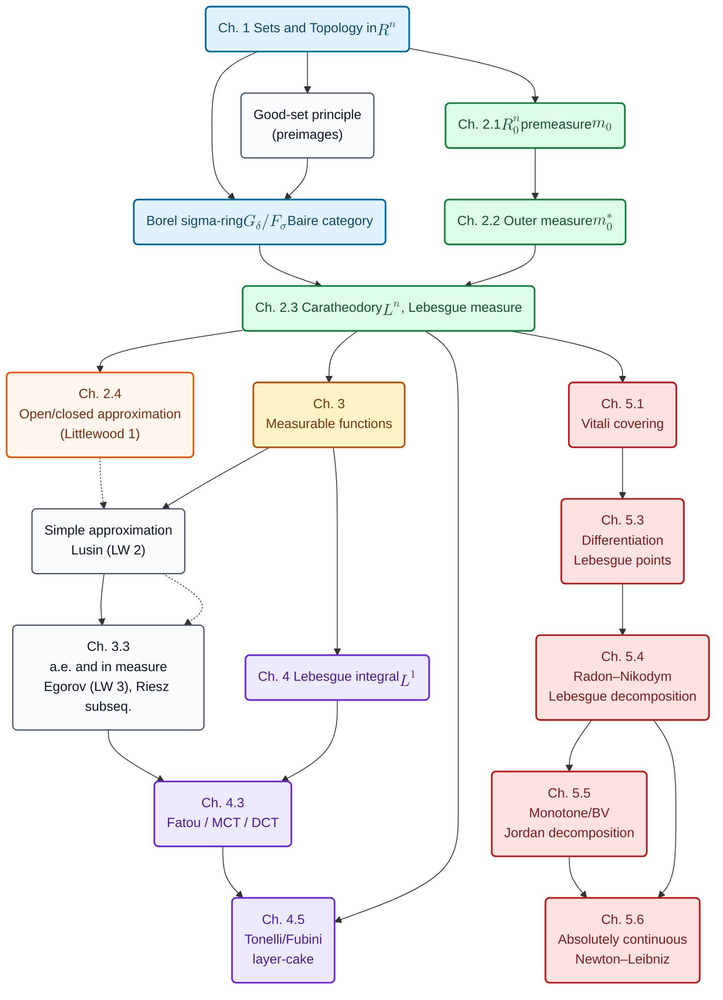

Back in 2011, I wrote a set of real analysis notes in Chinese at Nanjing University. They grew out of a course I took with Prof. Zhong Chengkui (钟承奎). It was my first exposure to real analysis, and it was an excellent experience. The course’s level of detail and rigor inspired me to pursue an academic path. Around that time I had just started using LaTeX, and these notes also became a practical way for me to learn it.

The notes were circulated on the university forum and on a Sina knowledge‑sharing platform [iask](http://iask.sina.com.cn/u/1776601564/ish), where they accumulated a few thousand downloads. That site has long since disappeared (it eventually became an online medical Q\&A portal). For years I have felt that the notes deserve a wider audience, and I have periodically considered translating them into English.

Recently, I revisited the manuscript and produced a complete English translation with ChatGPT. With the current generation of LLM-assisted tooling—especially the ability to edit files and iterate quickly through compilation and correction—the conversion process was far smoother than I expected. I ended up with a near‑perfect translation in about two hours. I hope the rise of LLMs can truly break down barriers to knowledge (and language) and make it accessible to everyone.

[Chinese version (original)](../assets/papers/Real_analysis.pdf) | [English version (translation)](../assets/papers/Real_analysis_en.pdf)

## Real Analysis

Real analysis begins as a continuation of calculus, but it matures the moment one recognizes that “well-behaved” functions are not the default. The subject is, in a precise sense, the art of building a calculus that survives contact with pathological examples: functions that oscillate too violently, sets too irregular to be described by elementary geometry, and limiting processes that destroy the very properties one hopes to preserve.

These lecture notes take a classical route through this landscape while remaining uncompromisingly modern in spirit. They do not treat measure theory as an isolated technical chapter appended to analysis; instead, they develop Lebesgue measure and the Lebesgue integral as the *structural repair* of the weaknesses of the Riemann integral and of pointwise calculus. Along the way, they show how the language of “almost everywhere” becomes not a convenience, but the correct level of resolution at which calculus is stable.

### Why another integral?

The opening discussion sets the agenda with three recurring themes.

First, **limits**. A sequence of continuous functions may converge pointwise to a function that is no longer continuous and may even fail to be Riemann integrable. Yet the integrals of the approximating functions may converge, suggesting that the integral itself—not merely the function class—should be redesigned to commute with limits under natural hypotheses.

Second, **geometry in the large**. The length of a curve, defined as the supremum of polygonal approximations, is a geometric quantity that can exist even when classical differentiability fails. The proper analytic condition turns out to be **bounded variation**, not differentiability, and the familiar arc-length formula requires additional care (often a reparameterization).

Third, **differentiation and integration**. The fundamental theorem of calculus is not wrong; it is *incomplete*. Its correct form requires the right notion of integrability (Lebesgue) and the right regularity class (absolute continuity). The notes return to this theme at the end, where differentiation is understood not only for functions, but for measures.

### The organizing philosophy

A guiding thread can be summarized in a small number of principles.

- Replace pointwise structure by *measure-theoretic structure*: work “up to null sets,” where the analytic objects behave robustly.
- Replace rigid descriptions by *approximation*: measurable sets are approximable by simple geometric sets, measurable functions by simple functions and by continuous functions on large subsets, and a.e. convergence by almost uniform convergence on large subsets.
- Replace ad hoc arguments by *closure principles*: define “good” families (good sets, good functions) and prove closure under the operations that generate the objects of interest.

These principles are not merely pedagogical; they are the mechanism by which the modern theory becomes usable.

## A road map of the text

### Chapter 1: Sets, topology, and descriptive foundations

The first chapter provides the language in which measure theory naturally lives. It treats set operations and the subtle notion of set limits via limsup and liminf, then develops the topology of \(\mathbb{R}^n\): open and closed sets, compactness (Heine–Borel), and the structural decomposition of open sets.

Two themes are particularly important for the sequel:

1. **Inverse images preserve structure.** This is the conceptual basis for both continuity (“preimages of open sets are open”) and measurability (“preimages of Borel sets are measurable”).
2. **Borel structure and category.** The Borel \(\sigma\)-ring generated by open (equivalently, closed) sets is introduced, and the Baire category theorem provides a parallel notion of largeness distinct from measure. This distinction—between “large in category” and “large in measure”—is a recurring source of insight (and of instructive counterexamples).

The chapter also develops extension tools (Tietze and Urysohn-type lemmas in \(\mathbb{R}^n\)), which later become the bridge between measurability and continuity in Lusin’s theorem.

### Chapter 2: Constructing Lebesgue measure

Measure theory is built, here, as it should be built: by construction rather than decree.

The notes begin on a concrete and tractable family of sets—finite unions of bounded left-open right-closed boxes—forming a ring \(R_0^n\). A pre-measure \(m_0\) (volume) is defined on this ring, and the central extension mechanism follows:

- **Outer measure** \(m_0^*\) is created by taking infima over countable covers.
- **Carathéodory measurability** is then used to *select* the sets on which outer measure behaves additively in the correct sense.
- The measurable class \(\mathcal{L}^n\) emerges as a \(\sigma\)-ring, and \(m\) becomes a genuine measure.

This chapter also clarifies how Lebesgue measurable sets relate to Borel sets, and why nonmeasurable sets are unavoidable (a Vitali-type selection argument illustrates the obstruction). Perhaps most importantly, it establishes the first of the “Littlewood principles”: measurable sets are close to simple geometric sets (open/closed approximations with small measure error).

### Chapter 3: Measurable functions and convergence

Once measurability of sets is in place, measurability of functions becomes a natural extension: a function is measurable if its superlevel sets are measurable. This choice is not arbitrary; it is engineered to make measurability stable under the operations analysis requires.

Two achievements dominate the chapter.

1. **Structural approximation.** Nonnegative measurable functions can be approximated from below by simple functions. Beyond that, Lusin’s theorem asserts that measurable functions are “almost continuous”: after discarding a set of arbitrarily small measure, one obtains continuity on a closed set. This is the second Littlewood principle: measurable functions are close to continuous ones.

2. **Modes of convergence.** The notes develop almost everywhere convergence and convergence in measure, show how they relate on finite-measure sets (Egorov’s theorem giving almost uniform convergence off a small exceptional set), and prove the Riesz subsequence principle (convergence in measure yields an a.e. convergent subsequence). These results supply a disciplined replacement for the brittle pointwise convergence arguments of elementary analysis.

A subtle warning closes the chapter: composition behaves cleanly for Borel measurability, but not necessarily for Lebesgue measurability, because inverse images of Lebesgue measurable sets need not stay within the Borel class. This is one of many reminders that “measurable” is a family of concepts, and one must keep track of which family is being used.

### Chapter 4: Lebesgue integration

With measurable functions available, integration is built so that approximation and limit-passing become central features rather than exceptional tricks.

The construction proceeds in stages:

- bounded measurable functions on finite-measure sets,
- nonnegative measurable functions on general sets via truncations and exhaustions,
- general integrable functions via positive and negative parts.

From this framework, the major limit theorems emerge in their natural form:

- Fatou’s lemma,
- monotone convergence (Levi),
- dominated convergence.

These theorems are the operational heart of Lebesgue integration; they explain, precisely, when integrals commute with limits.

The chapter culminates in Tonelli and Fubini theorems, which establish when iterated integrals represent multiple integrals and when one may exchange the order of integration. The layer-cake representation further reinforces the geometric intuition behind integration: a nonnegative function is integrated by measuring its superlevel sets.

Finally, the density of continuous compactly supported functions in \(L^1\) is proved, giving a powerful practical message: even though \(L^1\) functions may be highly irregular pointwise, they can be approximated in integral norm by smooth objects.

### Chapter 5: Differentiation of measures and the Newton–Leibniz formula

The final chapter returns to the fundamental theorem of calculus from a deeper vantage point: differentiation is not merely an operation on functions; it is an operation on measures.

The Vitali covering theorem provides the geometric engine needed to pass from local ball estimates to global measure statements. From it, the Lebesgue differentiation theorem follows: local averages of an \(L^1_{\mathrm{loc}}\) function converge to the function value almost everywhere. This is, in a precise sense, the restoration of pointwise information from integral data—on the correct “almost everywhere” scale.

Radon measures enter as the natural setting for measure differentiation, and the Radon–Nikodym theorem plays the role of a generalized Newton–Leibniz principle: absolute continuity of measures is equivalent to representability by a density function, and the density is obtained via differentiation of measures.

The chapter then specializes these ideas back to one-variable analysis. Monotone functions are differentiable a.e.; functions of bounded variation decompose as differences of monotone functions; absolutely continuous functions are exactly those for which the Newton–Leibniz formula holds in its strongest meaningful form:
\[
f(b)-f(a) = \int_a^b f'(t)\,dt.
\]
In this way, the text closes the loop: the modern integral is not a replacement for calculus, but its completion.

## How to read effectively

A reader will benefit from treating the text not as a list of theorems, but as a carefully staged construction.

- Read Chapters 1–2 as *foundational engineering*: you are building the universe in which the later theorems are true.
- Read Chapter 3 as *approximation technology*: it tells you how to replace irregular objects by regular ones without losing measurable/integral information.
- Read Chapter 4 as *operational calculus*: it supplies the limit-exchange tools that power most applications.
- Read Chapter 5 as *conceptual synthesis*: it explains why the measure-theoretic integral is the correct partner of differentiation.

The exercises should be treated as part of the narrative: many of the “obvious” implications in this subject become obvious only after one has practiced the closure arguments and approximation steps repeatedly.

## Theorem Cheat Sheet

### Topology / descriptive set tools

- **Heine–Borel (in \(\mathbb{R}^n\))**: compact \(\Leftrightarrow\) closed and bounded. Use: extract finite subcovers; prove existence of minimizers; regularity arguments.
- **Tietze extension (in \(\mathbb{R}^n\))**: bounded continuous on a closed set extends to bounded continuous on \(\mathbb{R}^n\). Use: upgrade Lusin closed-set continuity to global continuous approximation.
- **Baire category theorem**: \(\mathbb{R}^n\) is not a countable union of nowhere dense sets. Use: show sets like \(\mathbb{Q}\) cannot be \(G_\delta\), and \(\mathbb{R}\setminus\mathbb{Q}\) cannot be \(F_\sigma\).

### Measure construction / regularity

- **Outer measure properties**: monotone, countably subadditive; agrees with \(m_0\) on \(R_0^n\).
- **Carathéodory criterion**: the definition of Lebesgue measurable sets; proves \(\mathcal{L}^n\) is a \(\sigma\)-ring.
- **Approximation by open/closed sets**: basis for Littlewood principle 1 and many \(\varepsilon\)–\(\delta\) arguments.

### Measurable functions and convergence

- **Simple approximation**: reduces many proofs to finite sums.
- **Lusin**: measurable \(\approx\) continuous off a small-measure set.
- **Egorov (finite measure only)**: a.e. convergence \(\approx\) uniform convergence off a small-measure set.
- **Riesz**: convergence in measure \(\Rightarrow\) a.e. convergence of a subsequence.

### Integration

- **Tonelli (nonnegative)**: allows iterated integrals and swapping order.
- **Fubini (\(L^1\))**: same, under absolute integrability.
- **Layer-cake**: for \(f\ge 0\),
\[
\int_E f(x)\,dx=\int_0^\infty m(\{x\in E: f(x)>y\})\,dy.
\]
Use: distribution-function proofs, estimates, rearrangement-type arguments.

### Limit theorems

- **Fatou**: controls \(\int \liminf f_n\) in terms of \(\liminf \int f_n\) (with one-sided integrable control).
- **Monotone convergence (Levi)**: \(0\le f_n\uparrow f\) implies \(\int f_n\uparrow \int f\).
- **Dominated convergence (DCT)**: if \(f_n\to f\) (a.e. or in measure) and \(|f_n|\le F\in L^1\), then \(\int f_n\to \int f\).

### Differentiation / RN / BV / AC

- **Vitali covering**: converts local ball estimates into global a.e. statements.
- **Lebesgue differentiation**: identifies pointwise values from averages.
- **Radon–Nikodym**: represents absolutely continuous measures as densities.
- **BV**: differentiable a.e.; \(f'\in L^1\); variation bounds \(\int |f'|\).
- **AC**: the right class for Newton–Leibniz; excludes “singular” counterexamples.
